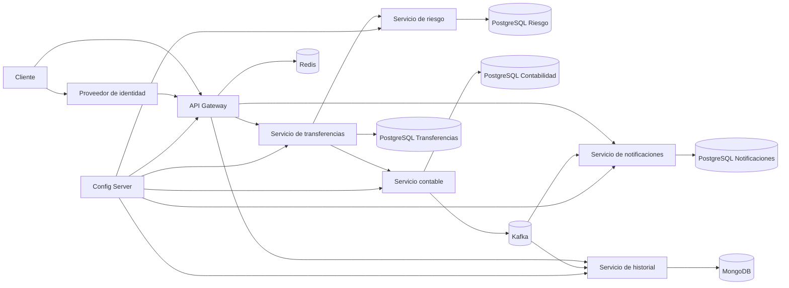
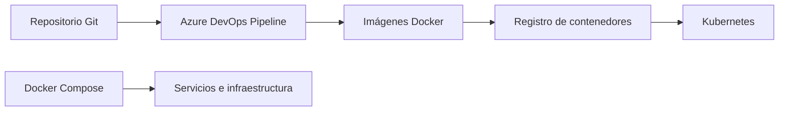

# Arquitectura del simulador de transferencias bancarias

> Proyecto de portafolio. Usa datos y dinero simulados; no se conecta a una entidad financiera real.

Este diagrama representa la arquitectura objetivo. El alcance del MVP y las etapas están definidos en [docs/README.md](docs/README.md).

## Diagrama de componentes

Vista de alto nivel de los componentes y sus conexiones.

El proveedor de identidad, Redis, Historial y Config Server ya están incorporados. Kubernetes corresponde a la siguiente etapa. El flujo principal de transferencias puede usar valores locales de respaldo si Config Server no está disponible y no depende de MongoDB para actualizar saldos. Cada servicio valida los permisos que le corresponden; el gateway no es la única barrera de autorización.

## Responsabilidades y conexiones

| Componente | Responsabilidad | Comunicación | Datos propios |
| --- | --- | --- | --- |
| API Gateway | Entrada pública, enrutamiento y límite de solicitudes | HTTPS/REST hacia servicios; Redis para límite distribuido | Ninguno |
| Transferencias | Validar solicitud, registrar estado e invocar riesgo y contabilidad | REST síncrono | PostgreSQL: transferencias y claves de idempotencia |
| Riesgo | Evaluar reglas de aprobación, rechazo o revisión manual | REST síncrono desde transferencias | PostgreSQL: reglas y decisiones |
| Contabilidad | Mantener cuentas, saldos y asientos; ejecutar débito y crédito atómicamente | REST síncrono; eventos salientes mediante outbox y Kafka | PostgreSQL: cuentas, asientos, comandos procesados y outbox |
| Notificaciones | Consumir eventos y simular envío de avisos | Kafka asíncrono | PostgreSQL: estado de entrega |
| Historial | Crear una vista de lectura para búsquedas y filtros | Kafka asíncrono | MongoDB: proyección reconstruible |
| Proveedor de identidad | Emitir tokens y gestionar usuarios de prueba | OAuth2/OIDC | Almacenamiento propio del proveedor |
| Config Server | Servir configuración versionada por ambiente | HTTP al iniciar los servicios | Repositorio de configuración |

**Propiedad de datos:** ningún servicio lee directamente las tablas de otro. La vista en MongoDB es una copia derivada; PostgreSQL en contabilidad sigue siendo la fuente de verdad para el dinero.

## Flujo de una transferencia interna

1. El cliente obtiene un JWT y llama a `POST /transferencias` con una clave de idempotencia.
2. El gateway enruta la solicitud. Transferencias verifica identidad, titularidad de la cuenta y validez del pedido; registra la solicitud y su estado.
3. Transferencias consulta a Riesgo. Una decisión negativa detiene el flujo. Si Riesgo no responde, la operación queda pendiente de revisión o se rechaza; nunca se aprueba por defecto.
4. Transferencias envía a Contabilidad un comando con un identificador estable. Si se repite, Contabilidad devuelve el resultado previamente registrado.
5. Contabilidad verifica saldo y moneda. En **una transacción local de PostgreSQL** registra los asientos de débito y crédito, actualiza el estado necesario y escribe el evento en la tabla outbox. Si falla cualquier paso, se revierte toda esa transacción.
6. Transferencias marca el resultado. Si la respuesta de Contabilidad se pierde, consulta o reintenta con el mismo identificador; no genera un segundo movimiento.
7. Un relay publica el evento de outbox en Kafka. Notificaciones e Historial lo consumen y deduplican por `eventId`. Su retraso o caída no revierte el movimiento contable.

**Regla central:** una transferencia interna no usa saga para mover dinero entre dos cuentas del mismo servicio contable. Una futura transferencia hacia un sistema externo sí requeriría una saga con reserva, confirmación o liberación de fondos y estados explícitos. Una transferencia ya liquidada no se “deshace” borrando asientos: se registra una operación compensatoria trazable cuando el negocio lo permita.

## Decisiones de confiabilidad

- Importes con tipo decimal y moneda explícita. Nunca usar `float` o `double` para dinero.
- Restricciones e índices SQL para identificadores únicos, cuentas y consultas frecuentes. Migraciones versionadas con Flyway.
- Control de concurrencia en Contabilidad para impedir sobregiros cuando llegan transferencias simultáneas.
- Idempotencia persistente tanto en la API de Transferencias como en el comando de Contabilidad.
- Outbox para unir el registro contable y el evento pendiente dentro de la misma transacción SQL. El relay puede publicar más de una vez; los consumidores deben deduplicar.
- Timeouts y circuit breaker para la llamada a Riesgo. Reintentos solo cuando la operación sea idempotente.
- JWT y autorización por cuenta en los servicios; secretos por variables de entorno o gestor de secretos, fuera del repositorio de Config Server.
- OpenAPI para contratos, Actuator y Micrometer para salud y métricas, y un identificador de correlación en logs y eventos.

## Infraestructura y entrega

En local, Docker Compose levanta las aplicaciones, PostgreSQL y, cuando corresponda, Kafka, Redis y MongoDB. El pipeline ejecuta pruebas unitarias e integración con Testcontainers, publica imágenes y despliega a un ambiente de prueba. Kubernetes es la etapa final: aloja los servicios sin alterar sus límites ni el flujo de negocio.

## Orden de implementación

1. **Base funcional:** Transferencias y Contabilidad, PostgreSQL, Flyway, OpenAPI, pruebas de concurrencia e idempotencia, Docker Compose.
2. **Seguridad y riesgo:** proveedor de identidad, JWT, autorización por cuenta, Riesgo, timeouts y circuit breaker.
3. **Eventos:** outbox, Kafka, Notificaciones y pruebas de duplicados y caída del broker.
4. **Operación:** métricas, trazas, pipeline de Azure DevOps y análisis de dependencias.
5. **Extensiones justificadas:** Redis para límite de solicitudes; MongoDB e Historial para una proyección de consultas; Config Server para configuración centralizada; Kubernetes para despliegue y escalado.

## Escenarios que debe demostrar el proyecto

- Una transferencia exitosa deja un débito y un crédito consistentes.
- Dos solicitudes con la misma clave producen un solo movimiento.
- Dos transferencias simultáneas no gastan el mismo saldo.
- La caída de Riesgo no aprueba la transferencia.
- La caída de Kafka no pierde un evento confirmado: permanece en outbox para su publicación posterior.
- Un evento duplicado no genera dos notificaciones ni dos entradas de historial.
