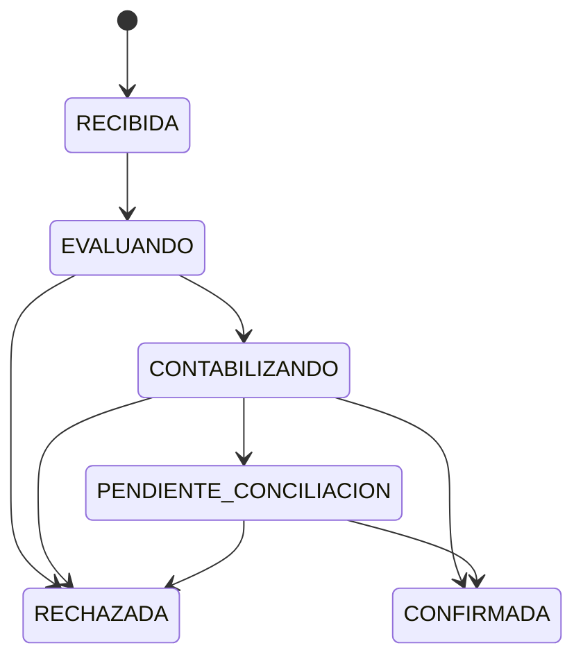
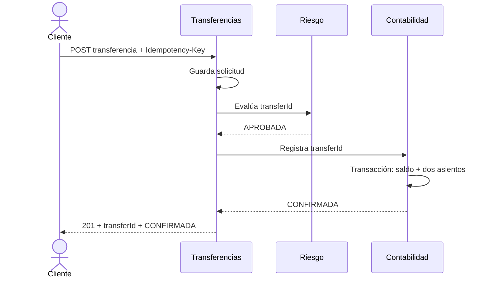

# Estados, secuencia y fallos

## Máquina de estados

`CONFIRMADA` y `RECHAZADA` son terminales. `PENDIENTE_CONCILIACION` indica que Transferencias desconoce el resultado contable, no que el dinero esté disponible. La conciliación consulta Contabilidad por el mismo `transferId`; si todavía no existe un resultado, reintenta el comando idempotente. También recupera operaciones que quedaron en `CONTABILIZANDO` tras una caída del proceso. Una ejecución puede pasar de `RECIBIDA` a un estado terminal dentro de la misma solicitud HTTP.

## Secuencia nominal

## Matriz de fallos

| Situación | Respuesta observable | Acción interna | Invariante |
| --- | --- | --- | --- |
| Misma clave y mismo cuerpo | Mismo `transferId` y estado actual | No crear otra transferencia | Un movimiento como máximo |
| Misma clave y cuerpo distinto | `409 IDEMPOTENCY_CONFLICT` | No procesar | Ningún movimiento nuevo |
| Cuenta de origen ajena, o cuenta inexistente | `404 ACCOUNT_NOT_FOUND` | No llamar a Riesgo ni a Contabilidad | No revelar otra cuenta |
| Saldo insuficiente | `RECHAZADA`, motivo `INSUFFICIENT_FUNDS` | Reversión de la transacción local | Saldos sin cambios |
| Riesgo rechaza | `RECHAZADA`, motivo `RISK_REJECTED` | No llamar a Contabilidad | Saldos sin cambios |
| Riesgo no disponible | `RECHAZADA`, motivo `RIESGO_NO_DISPONIBLE` | Timeout y circuit breaker | Saldos sin cambios |
| Respuesta de Contabilidad perdida | `202 PENDIENTE_CONCILIACION` | Consultar o reintentar con mismo `transferId` | Sin doble débito |
| Base de Contabilidad no disponible antes del commit | `202 PENDIENTE_CONCILIACION` | Reintento acotado y conciliación | Sin transferencia parcialmente confirmada |
| Kafka no disponible, fase posterior | Transferencia ya confirmada | El evento queda en outbox | El movimiento no se deshace |
| Evento Kafka repetido, fase posterior | Sin efecto duplicado | Consumidor deduplica `eventId` | Una proyección y un aviso lógico |

## Política de reintentos

- Se reintentan únicamente operaciones identificadas por `transferId` o `eventId` estable.
- Se aplican timeout y reintentos acotados con espera creciente. No hay bucles de reintento dentro de una transacción SQL abierta.
- La conciliación registra número de intentos y último error. Si supera el límite configurado, deja la operación visible para investigación; no declara `RECHAZADA` sin comprobar que Contabilidad no la confirmó.
- El consumidor de eventos confirma el mensaje solo después de persistir su resultado o de detectar que ya lo procesó.
