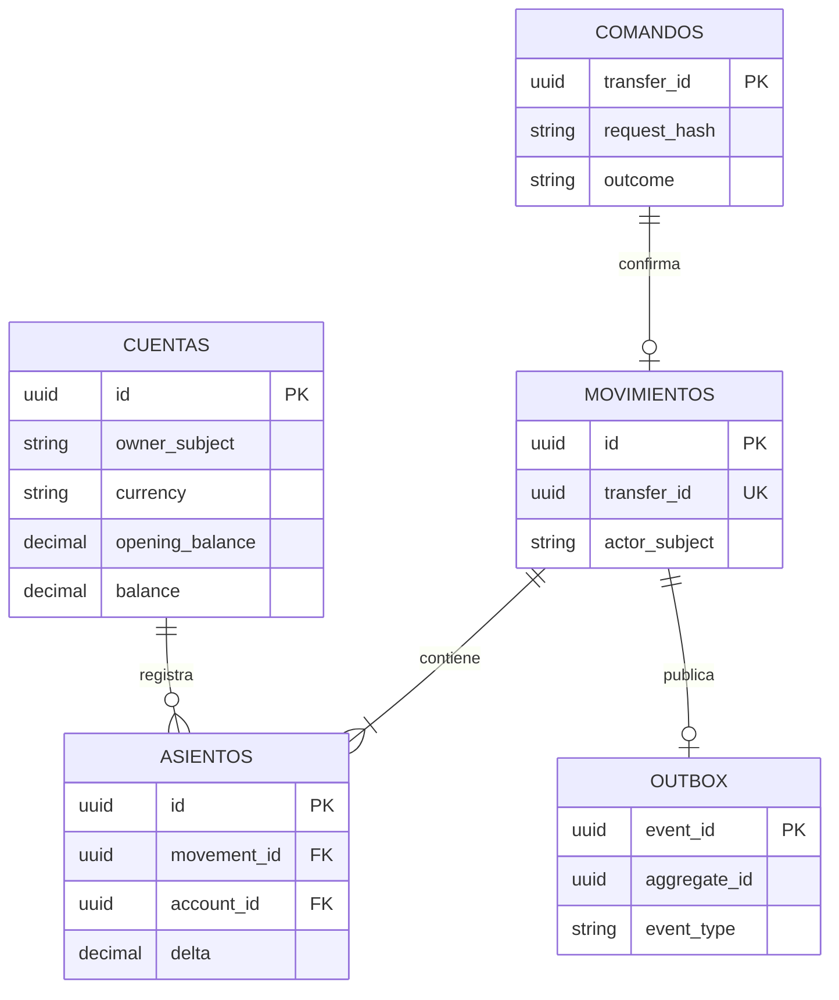

# Modelo de datos

Cada servicio es dueño de su base lógica y ejecuta sus propias migraciones Flyway. Para desarrollo local pueden residir en una misma instancia PostgreSQL con bases separadas. No hay claves foráneas entre servicios.

## Transferencias

| Tabla | Campos principales | Restricciones |
| --- | --- | --- |
| `transferencias` | `id uuid`, `owner_subject varchar(100)`, `source_account_id uuid`, `destination_account_id uuid`, `amount numeric(19,2)`, `currency char(3)`, `state varchar(32)`, `reason_code varchar(80)`, `idempotency_key uuid`, `request_hash char(64)`, `attempts`, `next_attempt_at`, `last_error_code`, `created_at`, `updated_at` | PK `id`; único `(owner_subject, idempotency_key)`; `amount > 0` |

Índices: `(owner_subject, created_at DESC, id DESC)` para el listado propio y un índice parcial por `next_attempt_at` para conciliación. La conciliación comparte la fila de `transferencias` y reclama lotes con `FOR UPDATE SKIP LOCKED`.

## Contabilidad

| Tabla | Campos principales | Restricciones |
| --- | --- | --- |
| `cuentas` | `id uuid`, `owner_subject varchar(128)`, `currency char(3)`, `status varchar(16)`, `opening_balance numeric(19,2)`, `balance numeric(19,2)`, `created_at` | PK `id`; `balance >= 0`; `currency = 'PEN'` en el MVP |
| `comandos` | `transfer_id uuid`, `request_hash char(64)`, `outcome varchar(16)`, `reason_code varchar(64)`, `movement_id uuid`, `created_at`, `updated_at` | PK `transfer_id`; conserva tanto confirmaciones como rechazos |
| `movimientos` | `id uuid`, `transfer_id uuid`, `actor_subject varchar(128)`, `created_at` | PK `id`; único `transfer_id` |
| `asientos` | `id uuid`, `movement_id uuid`, `account_id uuid`, `delta numeric(19,2)`, `created_at` | PK `id`; FK locales; `delta <> 0` |
| `outbox` | `event_id uuid`, `transfer_id uuid`, `event_type`, `schema_version int`, `payload jsonb`, `created_at`, `published_at`, `attempts`, `next_attempt_at` | PK `event_id`; único `transfer_id`; solo se escribe para `CONFIRMADA` |

En una sola transacción se bloquean las dos filas de `cuentas` en orden ascendente de UUID, se comprueba el saldo, se actualizan los saldos, se insertan un `movimiento`, dos `asientos` opuestos, el resultado en `comandos` y, en la fase de eventos, una fila `outbox`. Un rechazo se guarda en `comandos` sin cambiar saldos. `comandos.transfer_id` hace idempotente tanto una confirmación como un rechazo; `request_hash` detecta un cuerpo distinto. La suma de ambos `delta` debe ser cero; se comprueba en la lógica de dominio y en pruebas de integración.

`balance` es una proyección transaccional para consultas rápidas; los asientos constituyen el historial inmutable de transferencias. Las cuentas sintéticas nacen con `opening_balance`; una conciliación compara `balance` con `opening_balance + SUM(asientos.delta)`.

## Riesgo

| Tabla | Campos principales | Restricciones |
| --- | --- | --- |
| `evaluaciones` | `transfer_id uuid`, `request_hash char(64)`, `decision varchar(16)`, `reason_code varchar(80)`, `rule_version varchar(32)`, `created_at` | PK `transfer_id`; conserva decisión inicial e impide cambiar el cuerpo |

Las reglas de demostración son deterministas y versionadas. La misma solicitud de evaluación recibe la misma decisión.

## Incorporaciones posteriores

- **Notificaciones:** tabla `entregas` con `event_id` único, `transfer_id`, `owner_subject`, hash del evento, estado `SIMULADA` y fecha. La inserción por `event_id` deduplica entregas repetidas.
- **Historial:** colección MongoDB con `_id = transferId`, `ownerSubject`, importe, moneda, estado y fecha. Es una proyección reconstruible; no almacena el saldo oficial.
- **Redis:** límite de solicitudes del gateway; no almacena saldos ni claves de idempotencia como única fuente.

## Diagrama de entidades de Contabilidad

